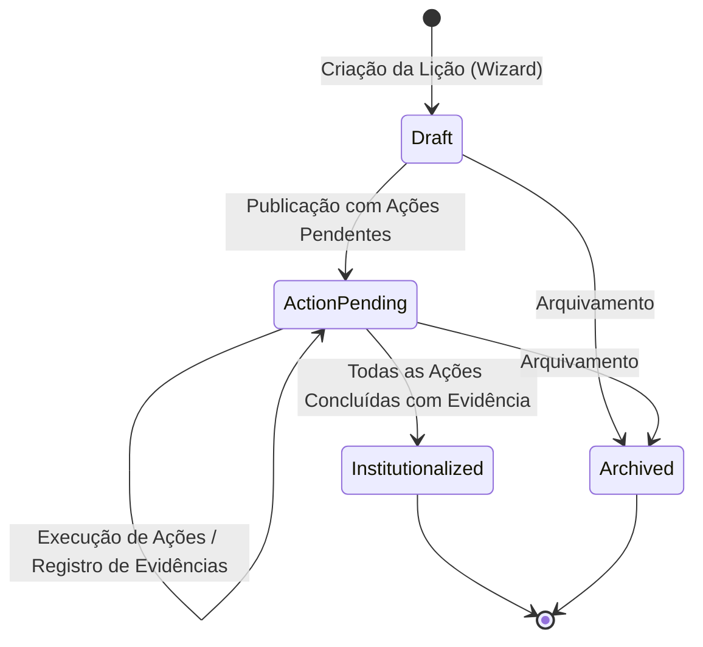

# Lessons Hub - Business Briefing (Global)

> **Descrição**: Visão unificada de negócio do Lessons Hub: conceito do produto, problema combatido ("Cemitério de Lições"), as 4 metodologias integradas (AAR, RCA, SECI, PDCA), fórmula do Índice Double-Loop Learning, papéis de usuário (RBAC) e ciclo de vida completo da lição (`LessonStatus`).

---

## 1. O que é o Lessons Hub?

O **Lessons Hub** é um sistema web corporativo sociotécnico voltado para a **gestão do conhecimento organizacional e prevenção de falhas reincidentes**. Ele conecta pessoas, processos e tecnologia para capturar, diagnosticar e institucionalizar aprendizados derivados de incidentes técnicos, post-mortems e encerramentos de projetos.

O sistema combate diretamente o problema crônico do **"Cemitério de Lições Registradas"**, assegurando que os aprendizados não fiquem restritos a documentos dispersos, planilhas esquecidas ou ao conhecimento tácito individual, mas sejam convertidos em conhecimento explícito, planos de ação práticos e melhorias efetivas de processo.

---

## 2. As 4 Metodologias Integradas

A arquitetura de negócio do Lessons Hub unifica quatro metodologias consagradas de engenharia de software e aprendizagem organizacional:

1. **AAR (*After Action Review*)** (Wizard - Etapa 1 / Registro Inicial):
   - Responde estruturadamente a quatro perguntas fundamentais:
     - *O que foi planejado?*
     - *O que de fato ocorreu?*
     - *Por que houve a discrepância?*
     - *O que aprendemos com a experiência?*

2. **RCA (*Root Cause Analysis* / Análise de Causa Raiz)** (Wizard - Etapa 2 / Diagnóstico):
   - Diagnóstico aprofundado do incidente através da técnica dos **5 Porquês**, identificando causas sistêmicas e avaliando a severidade do impacto, sem atribuição de culpa individual (*Blameless Postmortem*).

3. **Modelo SECI (Nonaka & Takeuchi)** (Fluxo Contínuo de Conhecimento):
   - Facilita a espiral do conhecimento organizacional:
     - **Socialização**: Compartilhamento e discussão de experiências entre equipes.
     - **Externalização**: Conversão do conhecimento tácito em lições estruturadas no sistema.
     - **Combinação**: Categorização, associação de tags (`#infraestrutura`, `#fornecedores`, etc.) e vínculo com projetos.
     - **Internalização**: Busca no acervo global e incorporação das práticas na rotina operacional.

4. **Ciclo PDCA (*Plan-Do-Check-Act*)** (Wizard - Etapa 3 e Acompanhamento de Ações):
   - **Plan**: Criação de planos de ação vinculados à lição, com responsável designado e prazo definido.
   - **Do**: Execução das ações pelas equipes responsáveis.
   - **Check / Act**: Validação com exigência obrigatória de **evidência prática descritiva de alteração de processo** para fechamento do ciclo.

---

## 3. Métrica Central: Índice Double-Loop Learning

O indicador-chave de governança da plataforma é o **Índice Double-Loop Learning** (destacado nos KPIs do Dashboard):

$$\text{Índice Double-Loop} = \left(\frac{\text{Lições com Ações Concluídas e Evidenciadas}}{\text{Total de Lições Publicadas}}\right) \times 100$$

Uma lição só é considerada **Institucionalizada** quando comprova que gerou uma mudança estrutural na cultura, documentação ou processos da organização, evitando soluções superficiais (*Single-Loop*).

---

## 4. Perfis de Usuário (Papéis de Acesso - RBAC)

| Papel | Responsabilidades no Negócio | Acesso na Interface |
| :--- | :--- | :--- |
| **Administrador (`Admin`)** | Gestão de usuários, governança irrestrita, exclusão de registros e parametrização geral da plataforma. | Acesso completo ao "Painel de Administração", abas `Usuários`, `Projetos`, `Lições`, `Categorias`. |
| **Gestor / Tech Lead (`Manager`)** | Curadoria do acervo, gestão de projetos/categorias, validação de diagnósticos, aprovação/institucionalização e monitoramento de KPIs. | Dashboard gerencial, criação/edição de categorias e projetos, aprovação de institucionalização de lições. |
| **Colaborador (`Contributor`)** | Vivência dos eventos, registro de incidentes, execução das ações sob sua responsabilidade e consulta ao acervo. | Dashboard, busca no acervo, criação via Wizard 3 etapas, edição de rascunhos próprios e registro de evidências em ações. |

---

## 5. Ciclo de Vida da Lição Aprendida (`LessonStatus`)

Cada lição transita por status rigorosamente mapeados pelo enum e domínio do sistema:

- **`Draft` (Rascunho)**: Lição em elaboração pelo autor ou salva temporariamente no Wizard para posterior edição; visível e editável pelo próprio criador.
- **`ActionPending` (Ações Pendentes)**: Lição publicada no acervo que possui planos de ação em aberto (status `Pending` ou `InProgress`) aguardando execução e comprovação por evidência prática.
- **`Institutionalized` (Institucionalizada)**: Todas as ações corretivas e preventivas foram 100% concluídas com evidência descritiva registrada, fechando o ciclo Double-Loop.
- **`Archived` (Arquivada / Inativa)**: Lição descontinuada ou arquivada por gestores/administradores.
